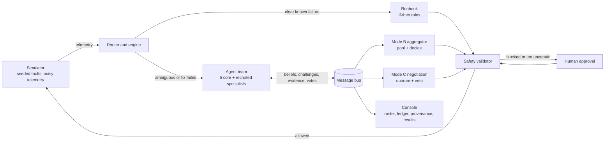

# GHOST PROTOCOL: when a runbook is not enough

Cisco Cloud AI Track 1, "When AI Agents Disagree" (Level 2, with the Level 3 negotiation mechanism).

> Everything here describes code in the repository and numbers that `uv run python eval/evaluate.py`
> reproduces. The AGNTCY integration is optional (`GHOST_AGNTCY=1`) and is described in section 4.

## 1. The idea in one paragraph

A pretend payments platform breaks. A fixed **runbook** (if-then rules) handles failures it
recognises, which is fast and cheap. When the evidence is ambiguous or misleading, a team of
five specialist **agents** takes over. Each agent sees only its own slice of the telemetry,
holds a **probability** for each possible root cause, and the team either pools its beliefs
through a central aggregator (Mode B) or negotiates peer to peer with no central decider
(Mode C). Every action passes a **safety validator**. When confidence is too low and the stakes
are too high, the system **asks a human**. We measure all of it against the runbook baseline.

The point of the project is the hand-off: deterministic rules where they are enough,
probabilistic agents where they are not, and a human when neither is safe.

## 2. How it meets the Level 2 and Level 3 criteria

| Criterion | Where it lives | Evidence |
|---|---|---|
| Dynamic discovery / capability-based selection | `agents/registry.json` (capabilities per agent), `agents/recruitment.py` | S3: the Network Analyst is recruited mid-incident by capability `dependency_timeout_analysis`; every selection is logged with its reason. With `GHOST_AGNTCY=1` the specialist is found by searching the **AGNTCY Directory** and the ledger names the record ID; otherwise `registry.json` is used |
| Response to an unexpected change or failure | `simulator/` (4 fault types, noise, flaky readings, decoys) | 4 scenarios, 100 seeds each (section 6) |
| Resolved conflicting recommendations | Mode B aggregator, Mode C negotiation | S2: Security alone says "attack" at 94%; adding the Deployment agent's evidence flips the team to "bad deploy" at 80% |
| Explanation of why agents were selected | `RECRUIT` messages, provenance drawer in the console | Ledger shows capability match and the triggering evidence |
| At least 3 agents with competing objectives | `registry.json`: goals, action costs, thresholds, vetoes | Gateway never wants customers locked out; Security blocks first; Deployment prefers rollback; Database refuses unsafe failover |
| Real negotiation mechanism, no central decider | `agents/negotiation.py` (Mode C) | Propose, challenge with evidence, update, vote (2/3 quorum, unanimity for risky actions, safety vetoes, 4 round limit) |
| Effect of new information | Challenge and evidence messages re-run the belief update | Belief bars change in the console after each exchange |
| Comparison against a simpler baseline | Mode A runbook, `eval/evaluate.py` | Section 6 |
| When to stop, keep disagreement, or ask a human | `intelligence/decision.py`, deadlock rule in negotiation | S5 escalates in 100% of runs; the rule is explained in section 5 |

## 3. Architecture overview



**Four ways to handle an incident** (the same engine runs all of them):

- **A, runbook only.** The baseline.
- **B, agents + central aggregator.** Beliefs are pooled, one rule decides.
- **C, peer negotiation.** No component pools anything; the protocol decides.
- **D, hybrid.** Runbook first. The router hands over to the agents when no rule matches, when two rules match at once, when the validator blocks the rule's fix, or when the fix fails.

**The simulated platform.** Four services (gateway, auth, payments, database), 30 ticks, a fault starting at tick 5 that ramps up over
4 ticks. Four hidden root causes: `bad_deploy`, `attack`, `db_fault`, `dependency_timeout`.
Readings carry about 10% noise and 5% of readings are replaced by random "flaky" values.

**Partial information.** Each agent sees only 3 features of its own (for example Database sees
replication lag, slow queries and lock waits). No agent can see the true cause, and no agent sees
everything. That is why they need each other.

**Scenarios** (a repeatable seed gives the same incident every time):

| | What happens | Why it is interesting |
|---|---|---|
| S1 | Clear database fault | The runbook should win; agents must not be worse |
| S2 | Bad deploy that looks like an attack on about 40% of seeds | The runbook's "error spike + odd traffic, so block" rule misfires |
| S3 | Dependency timeout | A specialist is recruited by capability |
| S5 | Database fault with attack-like decoys; failover is blocked (lag above the 12 s safe limit) and blocking traffic would lock out customers | Every fix is risky, so the right answer is to ask a human |

## 4. Technical implementation

**Beliefs (Bayes).** A belief is four probabilities, one per cause. For each clue (a feature reading
as low, medium or high) the engine multiplies each cause's probability by `P(clue | cause)` and
rescales. The table of `P(clue | cause)` is **learned from simulator runs** (`intelligence/estimate.py`:
200 plain incidents per cause on training seeds 1000 to 1199, counted with add-one smoothing), not
hand-picked. Evaluation seeds are 0 to 99, so nothing is tuned on test data.

**Calibration.** Treating correlated clues as independent makes Bayes overconfident. On the
ambiguous scenario S5 the raw engine claimed 93% confidence while being right 80% of the time.
A temperature of 0.5 on the clue strength brings the claim to 84% (best Brier score), so the
system's stated confidence is honest. (`eval/calibrate_beliefs.py`.)

**Pooling (Mode B).** Agents' beliefs are combined by a log-opinion pool (multiply and rescale), and
"we tried X and it did not help" lowers whichever cause X would fix.

**Decision rule.** Instead of fixed thresholds, `intelligence/decision.py` prices the three options
in ticks of pain and picks the cheapest:

- *Act now:* if wrong (chance 1 - p), we lose the hold period, maybe cause harm (locking out
  customers, an unsafe failover), and are still stuck.
- *Probe first:* costs a tick, halves the chance of being wrong, and a human is still available afterwards.
- *Ask a human:* a fixed delay, but the answer is right.

Thresholds fall out of the costs (retry 4, risky harm 8, human 3, probe 1 tick, all hand-set assumptions):
while probes remain, harmless fixes need about 72% confidence and risky ones about 87%; once both probes
are used, about 58% and 80%. A fix the validator blocks is never acted on. Every decision carries its numbers in plain English.

**Negotiation (Mode C).** Per round: every agent proposes; each challenges the most confident
disagreeing peer with its strongest discriminating evidence and asks for theirs; both update; everyone
votes accept, reject or veto. A proposal passes with a 2/3 quorum and no safety veto; risky actions need
everyone. If the whole team already names the same cause but the Database agent is not yet sure enough to
allow a failover, it asks its agreeing peers for their evidence before the vote (peers who agree never
challenge each other, so otherwise it would never hear it). Its belief rises only if that evidence supports it.
No agreement in 4 rounds means escalate to a human.

**Safety validator.** Plain code with the last word in every mode. Failover is safe below 5 s of
replication lag, risky between 5 and 12 s, blocked above 12 s unless a human approves. Blocking traffic is
always risky.

**LLM usage.** The LLM never produces probabilities and never chooses an action. It does two things:
(1) reads an agent's log lines and writes a short reason (`agents/evidence.py`), and (2) writes the wording
of challenges, the aggregator's explanation, the briefing a human reads before approving, and an end-of-run
summary (`agents/voice.py`). The feature levels the LLM reports are never used: the measured levels always
win, and any disagreement is only recorded. So beliefs, pooling, the cost rule, votes and the validator are
plain code that no LLM output can reach. Every LLM sentence a human can read goes through the same guard:
text that invents a number or names an action (and, for the voice layer, a cause not in the facts) is
discarded in favour of a template. The guard checks facts, not tone, so a technically accurate but
misleading sentence could still pass; the options table a human approves from is built by code. With no
key, or if a call fails, everything runs on templates. Calls are throttled to the provider's rate limit
and cached on disk.

**Console.** React + TypeScript: service graph with health colours, agent roster with live belief bars,
mode indicator with the reason for each switch, an action ledger filterable by agent, a provenance drawer
that follows a decision back to the messages behind it, the human approval panel, and a results tab.

**AGNTCY (optional, `GHOST_AGNTCY=1`; run guide in `docs/AGNTCY.md`).** With Docker running and the
Directory and trace pipeline from Cisco's coffeeAGNTCY setup up:

- *Directory:* each agent in `registry.json` is published as an OASF 0.8.0 agent card, and each gets a
  record ID that the console shows as an "AGNTCY" badge on its roster card. The Directory validates skills
  and domains against the standard OASF taxonomy, so our own capability tags live in the card's annotations.
- *Capability-based recruitment:* mid-incident, the Network Analyst is found by searching the Directory
  (the Directory cannot filter on annotations, so we search by author and match the capability in code).
  The ledger says "AGNTCY Directory search (record ...)". If Docker or the Directory is unavailable, it falls
  back to `registry.json` and says so.
- *Observability:* one OpenTelemetry trace per incident with one span per bus message (belief, challenge,
  veto, and so on), stored in ClickHouse and viewable in Grafana. The trace ID appears in the ledger header.
  Verified live: 6 cards published, S3 recruited via the Directory, 63 spans in one trace.
- *Safety of the integration:* off by default, never touched by evaluation runs (we checked: all 16 evaluation
  cells are identical with and without the integration code present), and it only wraps the start and end of a run.
- *Not done:* agents still talk over our in-memory bus, not A2A over SLIM. They run in one process, so SLIM
  would add risk without a visible benefit; the bus interface is publish/subscribe only so it can be swapped in.
  A spike showed SLIM working in coffeeAGNTCY's own demo (one trace spanning exchange, SLIM and farm).

**Engineering.** 114 automated tests (simulator determinism, partial observability, validator, runbook,
belief math, decision rule, voice guard, engine behaviour, AGNTCY on/off and fallback). Everything is seeded
and repeatable.

## 5. When the system stops, keeps disagreeing, or asks a human

- **Acts** when one fix is likely enough that being wrong costs less than waiting or asking.
- **Probes** (up to twice) when a cheap extra reading is worth a tick.
- **Asks a human** when the best fix is blocked by the validator, or confidence is too low for the risk.
  The approval panel shows each option with its probability and risk, and why the system is asking.
- **Keeps the disagreement** in Mode C when no proposal reaches quorum without a veto: it does not force
  consensus, it escalates with each agent's position attached.
- If the human rejects, the system holds for 4 ticks and deliberates again on fresh data.

## 6. Results

100 incidents per cell, scripted "oracle" human, no LLM. 95% confidence intervals in
`eval/results/REPORT.md`. Reproduce with `uv run python eval/evaluate.py`.

**Right diagnosis first time**

| Scenario | A Runbook | B Agents + aggregator | C Peer negotiation | D Hybrid |
|---|---|---|---|---|
| S1 clear DB fault | 100% | 100% | 100% | 100% |
| S2 deploy that looks like an attack | 75% | 100% | 100% | 97% |
| S3 dependency timeout | 98% | 100% | 100% | 100% |
| S5 ambiguous, high stakes | 0% | 97% | 98% | 94% |

**Recovery time (ticks from fault start; 30 means never recovered)**

| Scenario | A | B | C | D |
|---|---|---|---|---|
| S1 | 6.3 | 6.0 | 6.0 | 6.0 |
| S2 | 8.0 | 7.0 | 7.0 | 7.1 |
| S3 | 8.2 | 8.0 | 9.2 | 8.1 |
| S5 | 30.0 | 9.1 | 6.2 | 8.2 |

What this says:

- **On clear failures the agents cost nothing.** S1: same accuracy, marginally faster.
- **On misleading evidence they win.** S2: +25 points right first time (paired 95% interval +18 to +34),
  1 tick faster, and the runbook's wrong "block traffic" actions disappear.
- **The hybrid keeps most of that gain.** D is 97% right on S2 because the router hands over the moment two
  runbook rules match. The naive variant (first matching rule wins) is only 75% right, 8.0 ticks and 0.25
  wrong actions per run, so we report both (`eval/results/REPORT.md`, section 6). We chose the hand-off as the
  default after seeing that result.
- **On ambiguous high-stakes incidents the runbook cannot recover.** S5: it never recovers within 30 ticks
  (87% availability); the agents escalate in 100% of runs and recover in 6 to 9 ticks (97% to 98%).
- **Negotiation (C) is as accurate as the aggregator (B) with no central decider**, faster on S5
  (6.2 against 9.1 ticks) and slower on S3 (9.2 against 8.0).

**Ablation: remove one agent's evidence** (Mode B, S5 right-first-time): full team 97%; without Database
**0%**; without Payments 95%; without Deployment 98%; without Gateway 100%; without Security **100%**.
In Mode C, removing Database makes S1 escalate to a human only 1% of the time, because the blind Database agent
confirms with its peers; before that confirmation step existed it escalated every time, and 4% of full-team S1
runs also escalated for the same reason.

**LLM on versus off** (`eval/results/LLM_PROOF.md`): 8 incidents (S2 and S5, Modes B and C, 2 seeds), every
action, escalation, recovery time and correctness identical with the LLM on and off; 36 LLM-written lines,
none rejected, no failures. This is a small sample; it is a check, not a large study.

**Decision-rule variants** (Mode B): the expected-cost rule matches fixed thresholds on accuracy and,
unlike them, adapts to the cost of asking: when a human is cheap (cost 1) S5 recovers in 6.1 ticks instead
of 9.1, because the system stops probing and asks right away.

## 7. Lessons learned

1. **Deterministic first is right.** The runbook is as good as the agents on S1. Agents earn their cost only
   when evidence is ambiguous, so the router hands over only then.
2. **Disagreement carries information.** In S2 the Security agent is confidently wrong on its own. The value
   of the team is that Deployment's evidence overturns it. The ablation shows the flip side: in S5 the
   Security agent's decoy evidence hurts, and removing it improves accuracy, so more agents is not
   automatically better.
3. **Some agents are irreplaceable, some are redundant.** Database carries unique evidence for S5.
   Deployment's signal is inferred by elimination from the others in S2.
4. **Evaluation found two real bugs in our decision rule.** With an expensive human the rule "acted" on a fix
   with about a 1% chance of being right, because it priced a wrong action as cheap and forgot the problem
   would still be unsolved; and probing was over-priced. Both were fixed and have regression tests.
5. **Honest confidence needs calibration.** Raw Bayes claimed 93% where it was right 80% of the time.
6. **The LLM is most useful as a voice, not a brain.** Constraining it to wording kept every number and every
   action under code control. Free-tier rate limits (15 calls a minute) and 4 second calls shaped the design:
   call only at decision points, cache, throttle, always keep a template fallback.
7. **Cheap observability pays off.** A message ledger with provenance made debugging and the demo much easier.
8. **Adopt a standard, but keep it optional.** AGNTCY's agent-card format forced us onto a standard taxonomy,
   which is the point. Putting it behind a switch with a file fallback meant it could not break the demo or
   change a single evaluation number.

## 8. Limitations (what we would not claim)

- The simulator is synthetic, and the likelihood tables are learned from the same simulator that generates the
  test incidents (on different seeds). This shows the method works, not that it transfers to real systems.
- The human in S5 is a scripted oracle who approves the correct fix when it is offered. Real humans can be
  wrong or slow.
- The engine's validator reads the true replication lag in every mode, so the "unsafe action" column is 0% for
  all modes and does not discriminate between them. A standalone runbook that trusts noisy dashboards
  (`eval/run_scenarios.py`) causes an unsafe failover in about 34% of S5 runs.
- Mode D's hand-off when two runbook rules match (`escalate_on_conflict`) is on in the reported numbers. We
  switched it on after seeing the naive setting reproduce the runbook's S2 misfire (75% right against 97%), so
  that result is shown beside it rather than hidden.
- AGNTCY is used for the Directory (agent cards, capability-based recruitment) and for traces. Agent-to-agent
  messaging is not yet A2A over SLIM. With the Directory unreachable, each run waits several seconds on
  timeouts before falling back.
- Only four services are simulated (no cache). The recruited Network Analyst is chosen by capability; its
  readings overlap with the Gateway's, so what S3 demonstrates is discovery and recruitment, not extra evidence.
- Four hypotheses, five core agents. Scaling to many agents is supported by the registry and recruitment design
  but is not yet measured.

## 9. Reproduce

```bash
uv sync && cp .env.example .env            # add one LLM key (optional)
uv run pytest                              # 114 tests
uv run python eval/evaluate.py             # all tables above, about a minute
uv run python eval/evaluate_llm.py         # LLM on versus off (needs a key)
uv run python scripts/warm_llm_cache.py    # before demoing with the LLM box ticked
uv run uvicorn backend.main:app --port 8000   # console at http://localhost:8000
# AGNTCY Directory + traces (optional, needs Docker): see docs/AGNTCY.md, then
# uv sync --extra agntcy && GHOST_AGNTCY=1 uv run uvicorn backend.main:app --port 8000
```

Demo path (3 minutes): S1 Mode D (runbook handles it); S2 Mode A seed 2 (the runbook alone blocks traffic
wrongly and recovers late), then S2 Mode D seed 2 (the router sees two rules match, hands over at once, the team
rolls back); S3 Mode C (specialist recruited); S5 Mode C seed 1 (human approval panel);
then the Results tab.
